# Boletim Escolar — React + Vite

## Sobre o projeto

Este projeto foi desenvolvido como parte da Situação de
Aprendizagem do curso de Frontend do SENAI, sob a orientação
do professor Nivaldo Araújo.

A aplicação permite registrar as quatro notas bimestrais
de um aluno, calcular sua média aritmética e apresentar
sua situação escolar de forma dinâmica e interativa.

O projeto foi desenvolvido com React e Vite, aplicando
conceitos de componentização, props, gerenciamento de
estados, operadores ternários e estilização responsiva.

## Objetivos

- Desenvolver uma aplicação utilizando React e Vite.
- Trabalhar com componentes reutilizáveis.
- Utilizar props para comunicação entre componentes.
- Gerenciar estados com useState.
- Utilizar operadores ternários.
- Implementar formulários controlados.
- Validar os dados informados pelo usuário.
- Desenvolver uma interface responsiva.

## Tecnologias utilizadas

- React
- Vite
- JavaScript
- HTML5
- CSS3
- Node.js
- Git e GitHub

## Funcionalidades

- Cadastro do nome do aluno.
- Registro das quatro notas bimestrais.
- Cálculo automático da média aritmética.
- Classificação da situação escolar.
- Validação de campos vazios.
- Validação de notas entre 0 e 10.
- Exibição de mensagens de erro.
- Exibição e ocultação das notas.
- Alternância entre tema claro e escuro.
- Limpeza dos campos do formulário.
- Interface responsiva.

## Critérios de classificação

| Média | Situação | Cor |
| --- | --- | --- |
| Maior ou igual a 7 | Aprovado | Verde |
| Maior ou igual a 5 e menor que 7 | Recuperação | Laranja |
| Menor que 5 | Reprovado | Vermelho |

## Desafios de aprofundamento

Além das funcionalidades principais, foram implementados
quatro desafios adicionais.

### 1. Mensagem motivacional

Exibe uma mensagem diferente de acordo com a situação
escolar do aluno, utilizando um operador ternário.

### 2. Histórico da turma

Armazena os resultados dos cálculos em um estado do tipo
array e apresenta os registros em uma tabela.

### 3. Contador por situação

Apresenta a quantidade de registros de alunos aprovados,
em recuperação e reprovados, utilizando filter().length.

### 4. Lembrar o tema

Utiliza localStorage e useEffect para armazenar a
preferência de tema claro ou escuro no navegador.

## Componentes da aplicação

| Componente | Responsabilidade |
| --- | --- |
| Cabecalho | Apresenta o título e o botão de tema. |
| CampoNota | Componente reutilizável para os campos. |
| FormularioNotas | Gerencia e valida os dados do aluno. |
| CartaoResultado | Apresenta a média e a situação. |
| HistoricoTurma | Exibe o histórico dos registros. |
| ContadorSituacao | Exibe a quantidade por situação. |

## Estrutura do projeto

```text
boletim-escolar/
├── public/
├── src/
│   ├── components/
│   │   ├── Cabecalho.jsx
│   │   ├── Cabecalho.css
│   │   ├── CampoNota.jsx
│   │   ├── CampoNota.css
│   │   ├── FormularioNotas.jsx
│   │   ├── FormularioNotas.css
│   │   ├── CartaoResultado.jsx
│   │   ├── CartaoResultado.css
│   │   ├── HistoricoTurma.jsx
│   │   ├── HistoricoTurma.css
│   │   ├── ContadorSituacao.jsx
│   │   └── ContadorSituacao.css
│   ├── App.jsx
│   ├── App.css
│   ├── index.css
│   └── main.jsx
├── AUTOAVALIACAO.md
├── index.html
├── package.json
├── package-lock.json
├── README.md
└── vite.config.js
```

## Como executar o projeto

### 1. Instalar as dependências

```bash
npm install
```

### 2. Iniciar o servidor de desenvolvimento

```bash
npm run dev
```

### 3. Acessar a aplicação

Abra no navegador o endereço informado pelo Vite.

Normalmente:

http://localhost:5173/

### 4. Gerar a versão de produção

```bash
npm run build
```

## Testes realizados

- Validação de campos vazios.
- Validação de notas fora do intervalo permitido.
- Classificação de alunos aprovados.
- Classificação de alunos em recuperação.
- Classificação de alunos reprovados.
- Exibição e ocultação das notas.
- Alternância entre os temas.
- Limpeza do formulário.
- Mensagens motivacionais.
- Registro do histórico da turma.
- Contagem por situação.
- Persistência da preferência de tema.
- Responsividade da interface.
- Verificação do console do navegador.
- Compilação para produção.

## Resultados dos testes

Todos os testes funcionais realizados foram concluídos
com sucesso.

A compilação para produção também foi concluída com
sucesso, com 29 módulos processados em 490 ms.

## Observações

O histórico da turma permanece disponível durante a
sessão da aplicação e é reiniciado ao recarregar a página.

A preferência de tema permanece armazenada no navegador
por meio do localStorage.

## Evidências do funcionamento

### 1. Tema escuro

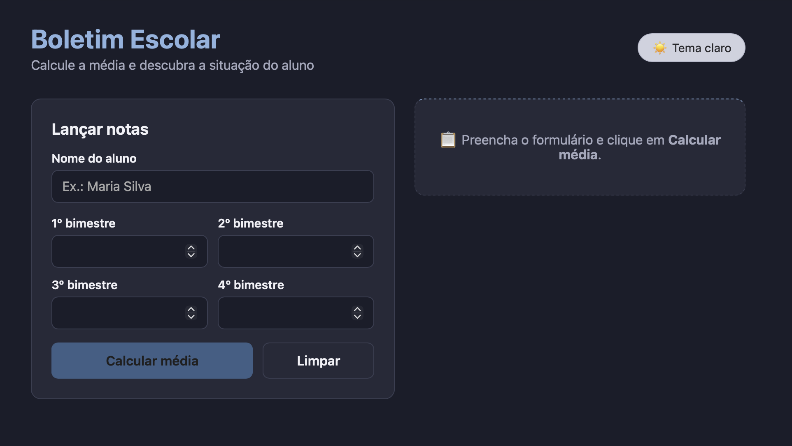

### 2. Formulário inicial

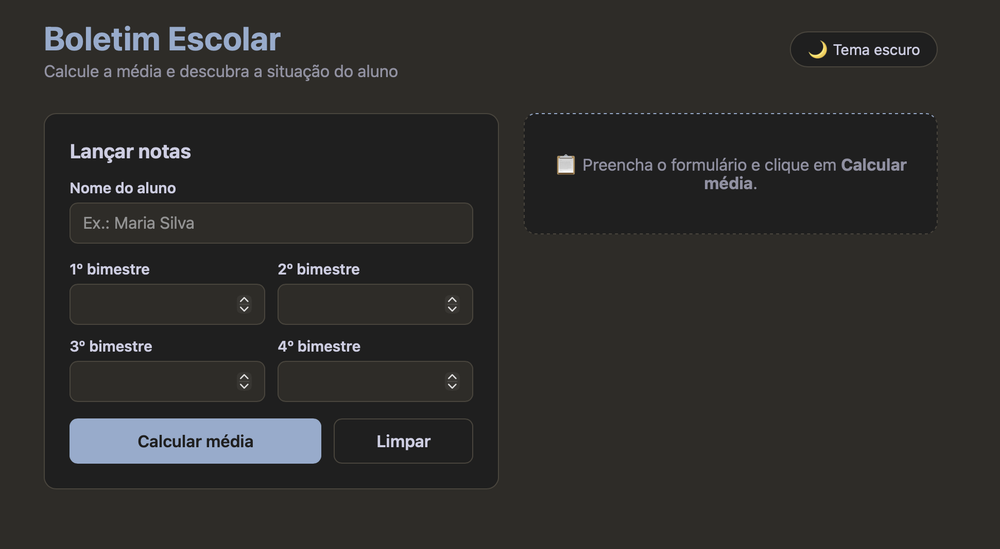

### 3. Validação de campos vazios

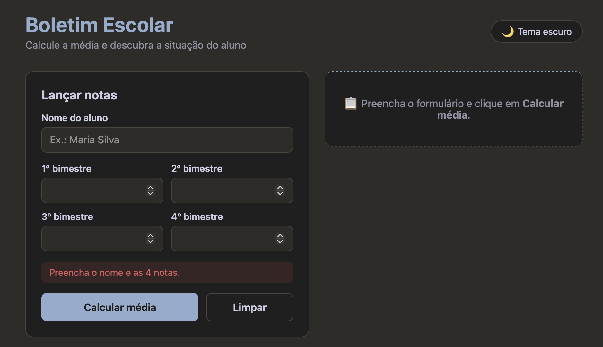

### 4. Validação de notas fora do intervalo

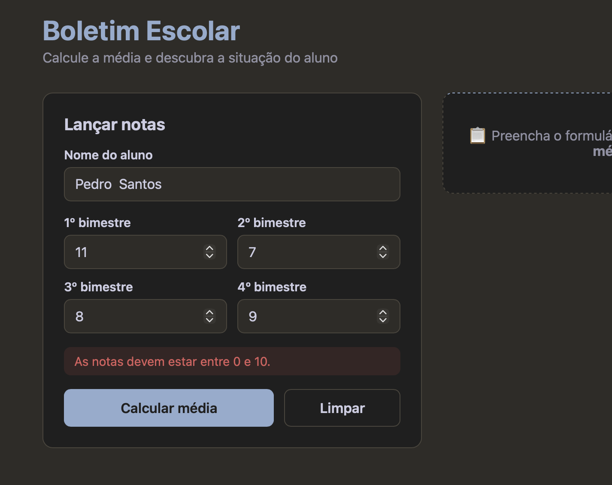

### 5. Aluno aprovado — Média 7.0

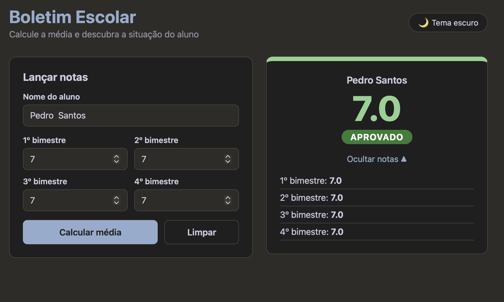

### 6. Aluno em recuperação — Média 5.0

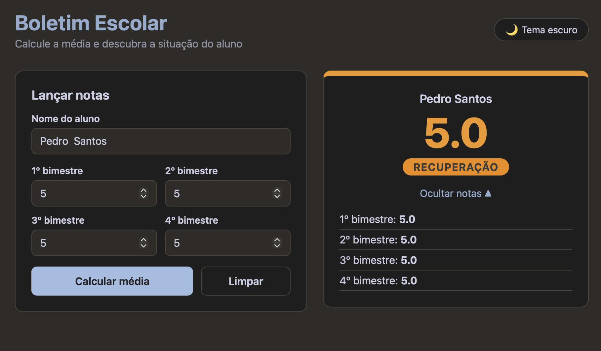

### 7. Aluno reprovado — Média 4.5

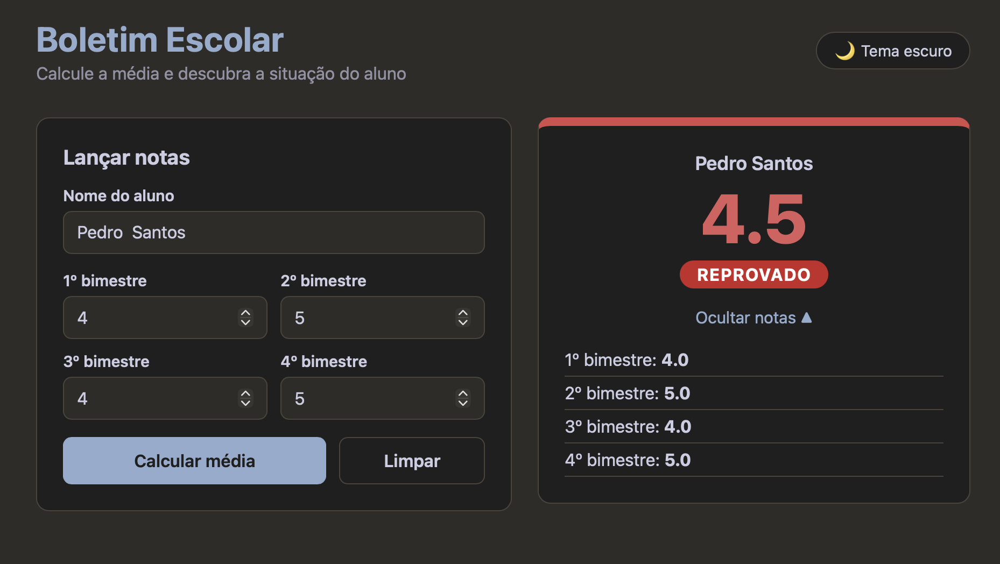

### 8. Mensagem motivacional

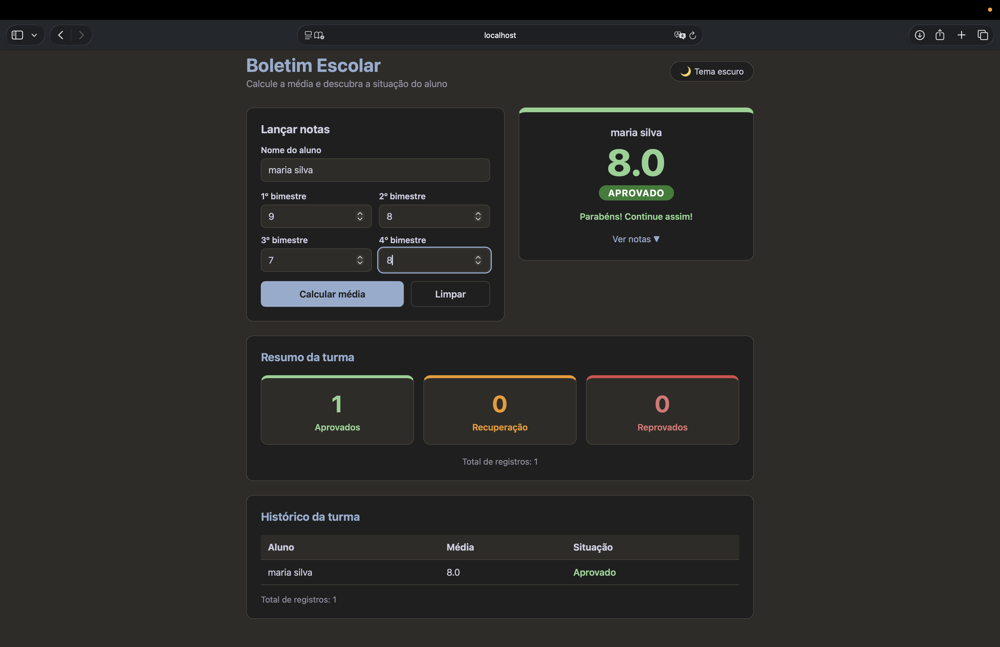

### 9. Histórico da turma

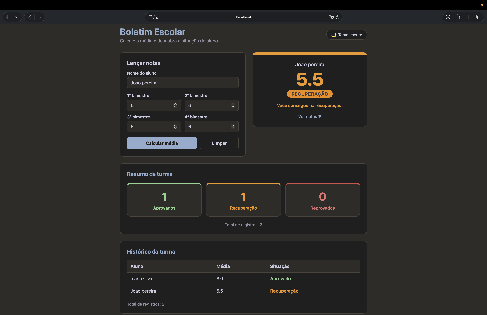

### 10. Contador por situação

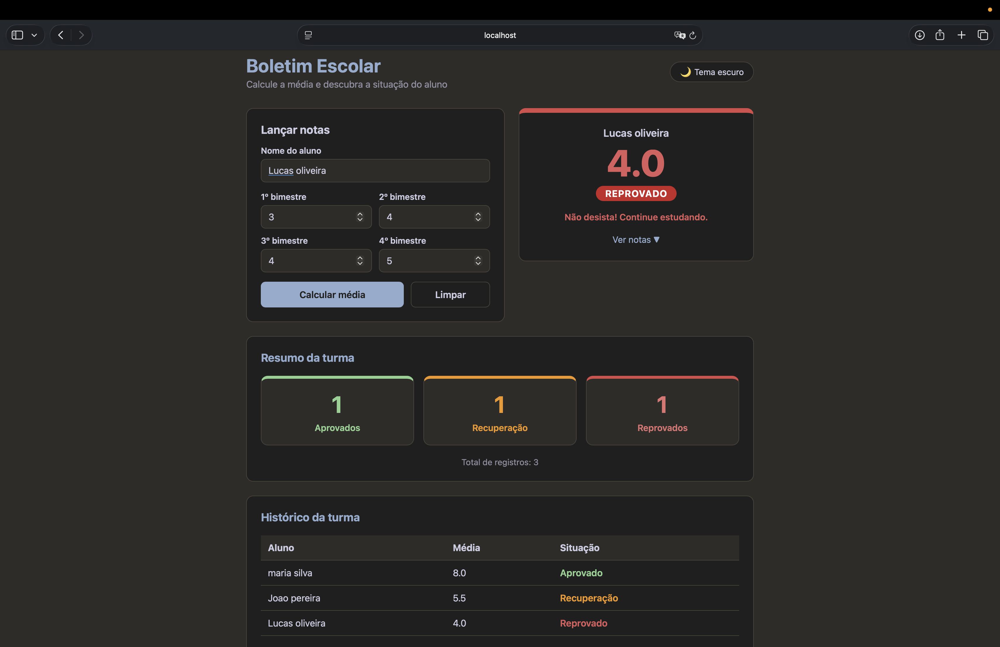

### 11. Histórico completo da turma

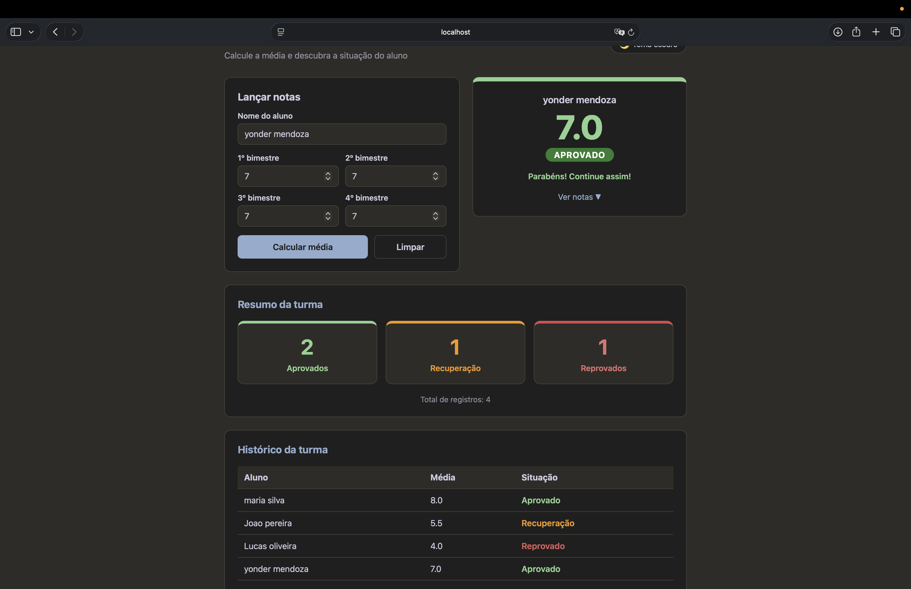

### 12. Aluno aprovado no tema escuro

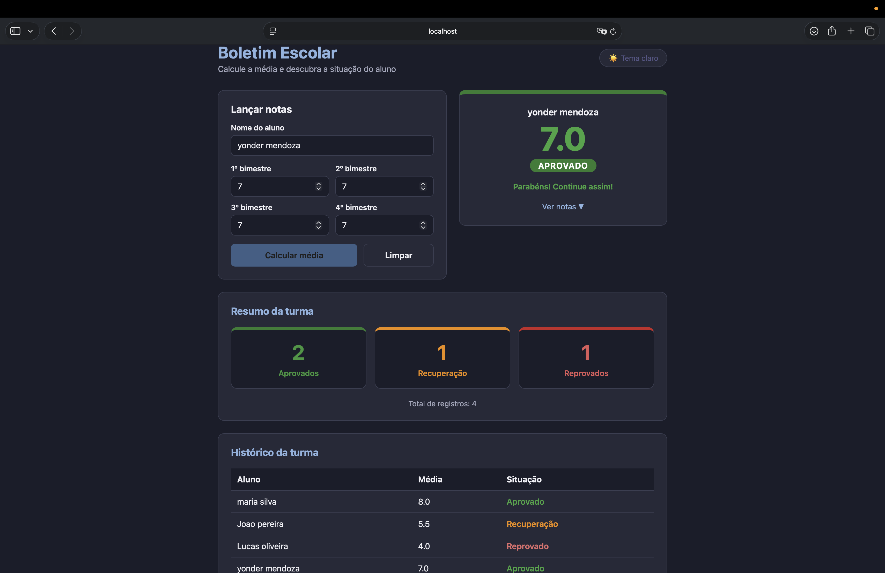

---

## Autoavaliação

As respostas da autoavaliação estão disponíveis no
arquivo [AUTOAVALIACAO.md](./AUTOAVALIACAO.md).

## Conclusão

O desenvolvimento deste projeto permitiu aplicar na prática
os conhecimentos adquiridos durante as aulas de Frontend.

A atividade contribuiu para o aprendizado de React,
componentização, gerenciamento de estados, operadores
ternários, validação de formulários e desenvolvimento
de interfaces responsivas.

## Informações acadêmicas

- Instituição: SENAI
- Curso: Frontend
- Professor: Nivaldo Araújo
- Projeto: Boletim Escolar com React + Vite
- Ano: 2026